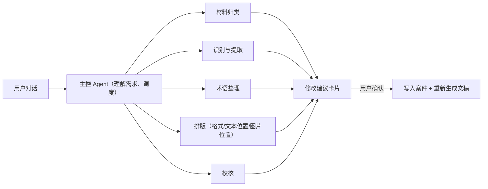

# 项目 TODO 总表（TODO.md）

> 产品定位：**法医文书整理 Agent 系统**。一个主控 Agent 理解用户需求、调度子智能体，
> 把委托书/记录本/照片整理成规范报表；用户通过**对话**决定内容、格式、文本位置、图片位置等细节，
> 并在前端**自带 API 与提供商**接入 AI。
>
> 项目文档约束：常驻文档仅保留 `AGENTS.md` 与本文件 `TODO.md`，其余历史/过程文档生命周期不超过 1 天。

图例：✅ 已有 · 🟡 部分具备 · ⬜ 未开始 · 优先级 P0（本轮）> P1（下一轮）> P2（之后）

---

## 0. 现状盘点（实测）

| 能力 | 状态 | 说明 |
| --- | --- | --- |
| 上传 → 一键整理 → 下载 Word/PDF（`quick-run`） | ✅ | 主流程可用，结果页可下载 |
| 字段/损伤提取、术语规则、模板填充、校核清单、修正记录、版本 | ✅ | 后端已完成，测试全部通过 |
| 部位照片按位置插入（不读图片内容） | ✅ | 18 个栏位 |
| AI 接入 | 🟡 | 只有 DeepSeek 一家；只能“测试连接”，**没有任何功能实际用到 AI**；密钥一刷新就丢 |
| 对话式微调 | ⬜ | 完全没有：用户只能在表格里手动改字段、选下拉框 |
| 调整格式（字号、行距、图片大小、栏目顺序） | 🟡 | 只有栏目顺序与损伤顺序；字号/行距/图片尺寸不可调 |
| 文稿预览 | ⬜ | 只能下载后打开 |
| 用户友好的界面 | ⬜ | 偏开发者控制台，见第 1 组 |
| 真实 OCR（PaddleOCR） | ⬜ | 当前只有离线演示引擎（TODO-DL-2） |

---

## 1. 用户友好的工作台（去控制台化）

| ID | 优先级 | 任务 | 验收 |
| --- | --- | --- | --- |
| UX-1 | P0 | 界面文案去掉需求编号（R-xx/N-xx/INV）、TODO-DL 编号、`AGENTS.md`、接口路径（`POST /api/...`）、请求头名、`kind=`/`media=`/`base64`/`bbox` 等内部字段 | 模板里扫不到上述模式（加一条自动化护栏测试） |
| UX-2 | P0 | 导航从 7 项两组（“主流程（Transparent）/次级界面”）简化为：**新建整理 / 我的案件 / 设置** | 不再有“需要先选案件才能点”的空入口；“复核中心”并入案件列表的筛选 |
| UX-3 | P0 | 红线提示合并为一处简短说明（“系统不会查看照片内容，空白写‘未记录’，鉴定意见由您填写”），不在每页、每个文件上反复出现 | 每页最多一处 |
| UX-4 | P0 | 上传页：去掉 base64 体积估算、accept 列表、media 类型芯片；类型选择改为下拉，默认“自动识别”；可选信息收进“补充信息（可不填）” | 首屏只有拖拽区 + 输出格式 + 开始按钮 |
| UX-5 | P0 | 进度显示改为清晰的步骤列表（上传 → 识别 → 整理 → 生成），不再显示“服务端不回报百分比” | — |
| UX-6 | P0 | 错误提示改为“发生了什么 + 怎么办”，不展示状态码；409 统一为“内容已被更新，已为您刷新” | — |
| UX-7 | P0 | 设置页：引擎状态、待下载依赖、已知限制收进折叠的“系统诊断”，默认只显示“AI 服务”和“术语规则” | — |
| UX-8 | P1 | 案件工作台：10 阶段步骤条与“推进/回退阶段”按钮收进“高级”；默认显示 4 步进度（材料 → 核对 → 文稿 → 交付） | — |
| UX-9 | P1 | 字段核对：用原图局部高亮代替 bbox 数字；8 列来源信息折叠为“查看来源” | 仍满足“每个字段都能看到 8 项来源信息” |
| UX-10 | P1 | 文稿内嵌预览（PDF 在页面内打开），与对话面板并排 | — |
| UX-11 | P2 | 真实进度：`quick-run` 改为后台任务 + 轮询/SSE | 进度来自服务端 |
| UX-12 | P2 | 无障碍与移动端适配复查 | — |

## 2. AI 接入：用户自带 API 与提供商

| ID | 优先级 | 任务 | 验收 |
| --- | --- | --- | --- |
| AI-1 | P0 | 前端“AI 服务设置”：选择提供商（DeepSeek、通义千问、Kimi、智谱 GLM、硅基流动、OpenAI、本地 Ollama、自定义 OpenAI 兼容）→ 自动填好地址 → 填 Key → 选模型 → 测试连接 | 切换提供商后地址/模型自动带出；测试成功后显示“已连接 · 模型名” |
| AI-2 | P0 | 后端 `llm.py` 改为通用 OpenAI 兼容客户端；提供商预设表；`verify` 返回可用模型列表 | MockTransport 测试覆盖各预设 |
| AI-3 | P0 | 请求头改为通用的 `X-LLM-API-Key` / `X-LLM-Base-URL` / `X-LLM-Model` / `X-LLM-Provider`，保留 `X-DeepSeek-API-Key` 作为兼容别名；密钥仍**不写库、不写日志** | 现有测试不回归；新增“密钥不出现在响应/日志”测试 |
| AI-4 | P0 | 自定义地址的安全限制：预设地址始终允许；自定义地址在服务器部署时受 `FORENSIC_LLM_ALLOWED_HOSTS` 白名单约束（本机默认放行） | 非白名单地址返回清晰错误 |
| AI-5 | P1 | AI 用在实际流程里：整理时可勾选“AI 辅助提取”（已有 `extract_with_llm`，只挑选并标注来源，不补事实） | 模型输出的值必须能在原文中找到，否则丢弃（现有逻辑） |
| AI-6 | P2 | 非 OpenAI 协议（Anthropic、Gemini 原生）适配器 | — |

## 3. 对话式 Agent（主控 Agent + 子智能体）

| ID | 优先级 | 任务 | 验收 |
| --- | --- | --- | --- |
| AG-1 | P1 | `POST /api/cases/{id}/chat`：读取案件快照 → 调模型 → 返回“回复 + 修改建议列表”。**本调用不写库**（满足“模型请求期间不持有写事务”） | 测试：调用前后案件 `version` 不变 |
| AG-2 | P1 | 修改建议白名单（每类映射到已有接口）：字段更正、损伤更正/排序、术语应用、栏目顺序、照片位置/顺序/说明、排版参数、重新生成文稿 | 白名单外的操作一律丢弃 |
| AG-3 | P1 | `POST /api/cases/{id}/proposals/apply`：逐条校验后执行，写入修正记录（修改前/后、原因、确认人、范围），带 `expected_version` | 每条应用都产生修正记录；版本冲突 409 |
| AG-4 | P1 | 红线在服务端强制执行：建议里出现鉴定意见写入 → 丢弃；事实类修改必须引用用户原话或原始材料；不得补充原文没有的数量/形态/颜色 | 专门的红线测试 |
| AG-5 | P1 | 前端对话面板：案件页右侧；建议以卡片展示（修改前 → 修改后、影响哪份文稿），可逐条确认/全部应用排版类 | — |
| AG-6 | P1 | 子智能体提示词与职责内聚于后端运行时模块 | — |
| AG-7 | P2 | 对话记录按案件保存（不跨案件复用） | 案件隔离测试 |
| AG-8 | P2 | 术语规则学习：对话中的术语纠正可建议为“以后通用规则”，需明确适用范围后才生效 | — |

## 4. 文书质量：格式、文本位置、图片位置

| ID | 优先级 | 任务 | 验收 |
| --- | --- | --- | --- |
| DOC-1 | P1 | 案件级排版参数 `layout`（正文字号、行距、首行缩进、照片宽度、是否显示照片说明）+ docgen 支持 | 生成的 docx 中实际生效 |
| DOC-2 | P1 | 文本位置：栏目顺序（已有）、损伤顺序（已有）、照片栏位顺序与照片说明在对话中可调 | — |
| DOC-3 | P2 | 模板管理：上传机构自己的模板，自动检测占位符并提示缺失项 | — |
| DOC-4 | P2 | 生成后排版自检（文字溢出、图片跨页）进入校核清单 | — |

## 5. 识别、外部依赖与样本（原 TODO-DL-1～7 并入）

> 演示案件使用内置合成数据与程序化模板；在正式实样测试前，**不承诺识别率或节省时间**（R-52 / R-53）。

| ID | 原编号 | 任务 | 未安装/未提供时的降级行为 |
| --- | --- | --- | --- |
| OCR-1 | TODO-DL-2 | 接入 `paddleocr` + `paddlepaddle`（中文印刷/手写） | `paddle` 引擎 `available() == False`，显式调用返回 409 并提示改用离线 `sidecar` 引擎 |
| OCR-2 | TODO-DL-5 | 云端 OCR 对比选型 | 预留 `ocr.register_engine()` 扩展点 |
| OCR-3 | TODO-DL-4 | `pypdfium2` | 优先使用已安装的 `PyMuPDF`（`fitz`）渲染 PDF 页面 |
| OCR-4 | TODO-DL-1 | `docxtpl` | 自动回退内置 `builtin` 渲染器（`python-docx` + `Jinja2`） |
| FE-BUILD | TODO-DL-3 | 前端 npm 依赖构建（`vue`、`vite`、`tailwindcss`、`lucide-vue-next`） | 本机已构建 `frontend/dist` |
| DATA-1 | TODO-DL-6 | 真实样本 + 已审核文稿，建立正确答案 | 使用内置演示案件与程序化生成的演示模板，**不承诺识别率或节省时间** |
| DATA-2 | TODO-DL-7 | 真实部位照片样本 | 演示案件使用程序化纯色占位图；系统只按用户指定位置插入，不识别照片内容（N-11） |

## 6. 工程与部署

| ID | 优先级 | 任务 |
| --- | --- | --- |
| ENG-1 | P0 | 两套前端（Vue 源码 + `frontend/static` 手写工作台）维护成本翻倍 → 退役 `frontend/static`，只保留 Vue 版（见 D-1） |
| ENG-2 | P1 | 根目录 `_probe_*` 与临时测试残留清理（本次已执行） |
| ENG-3 | P1 | 乐观锁收敛为真正的事务级 |
| ENG-4 | P1 | 修改字段确认值时把复核状态打回“待核对” |
| ENG-5 | P2 | 部署流程加入 `npm run build`，服务器只托管构建产物 |

---

## 7. 已确认的决策

| # | 决策 |
| --- | --- |
| D-1 | 退役 `frontend/static`，只保留 Vue 版；部署时执行 `npm run build` |
| D-2 | API Key 默认只在当前标签页有效（关闭即清除），可勾选“在本机记住”；提供商/地址/模型记在本机 |
| D-3 | 请求头改为 `X-LLM-API-Key`（保留 `X-DeepSeek-API-Key` 兼容别名），同步更新 `AGENTS.md` |
| D-4 | 项目只保留 `AGENTS.md` 与 `TODO.md`，其余历史文档生命周期仅 1 天 |
